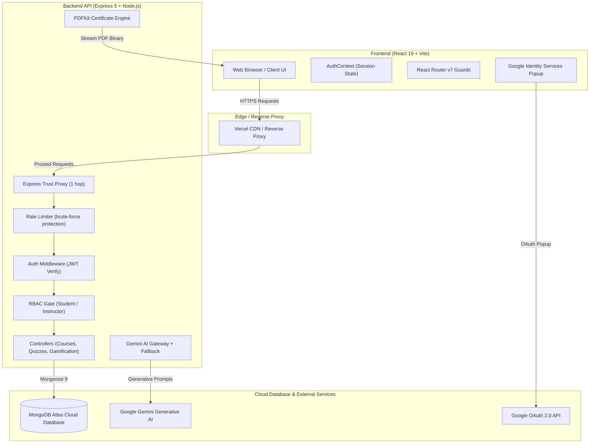
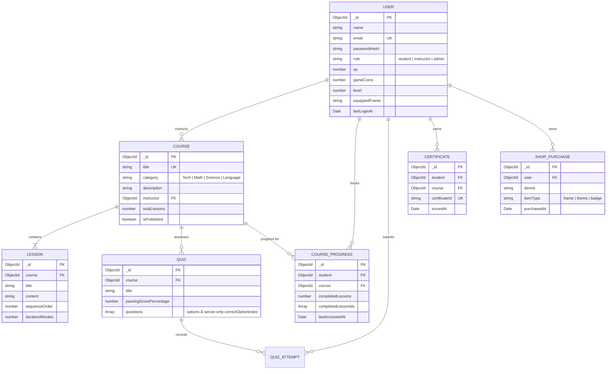

<p align="center">
  
</p>

<h1 align="center">🚀 LearnCraft LMS</h1>

<p align="center">
  <strong>Next-Generation, AI-Powered Full-Stack Learning Management & Gamification Platform</strong>
  <br />
  <em>Empowering students through AI tutoring, interactive arcade games, and verifiable credentials — while providing educators with a robust, data-driven Instructor Studio.</em>
</p>

<p align="center">
  <a href="#-automated-testing--verification"></a>
  
  
  
  
  
</p>

<p align="center">
  <a href="#-interactive-quick-start">⚡ Quick Start</a> •
  <a href="#-key-features--capabilities">✨ Features</a> •
  <a href="#-system-architecture--diagrams">🏗️ Architecture</a> •
  <a href="#-gamification--arcade-engine">🕹️ Gamification</a> •
  <a href="#-api-specification">📡 API Reference</a> •
  <a href="#-production-deployment-guide">☁️ Cloud Deployment</a> •
  <a href="#-interactive-live-demo-checklist">🎯 Demo Checklist</a>
</p>

---

## ⚡ Interactive Quick Start

<details open>
<summary><b>🚀 Run Locally in Under 60 Seconds (Click to expand / collapse)</b></summary>
<br />

### Prerequisites
- **Node.js**: v18.0.0+ (Node.js 20+ LTS recommended)
- **npm**: v9.0.0+
- **MongoDB**: MongoDB Atlas connection string or local MongoDB instance

---

### Step 1: Clone & Configure

```bash
# Clone the repository
git clone https://github.com/gayanviduranga95/Learn-Craft.git
cd Learn-Craft
```

#### Backend Environment (`backend/.env`):
```dotenv
PORT=5000
NODE_ENV=development
CLIENT_ORIGIN=http://localhost:5173
MONGODB_URI=your_mongodb_atlas_connection_string
JWT_SECRET=super_secret_learncraft_key_change_in_production
JWT_EXPIRES_IN=7d
GEMINI_API_KEY=your_gemini_api_key_optional
GOOGLE_CLIENT_ID=your_google_oauth_client_id.apps.googleusercontent.com
```

#### Frontend Environment (`learncraft/.env`):
```dotenv
VITE_API_BASE_URL=http://localhost:5000/api
VITE_GOOGLE_CLIENT_ID=your_google_oauth_client_id.apps.googleusercontent.com
```

---

### Step 2: Start the Development Servers

<table>
<tr>
<th width="50%">🖥️ Backend Server (Port 5000)</th>
<th width="50%">🌐 Frontend Client (Port 5173)</th>
</tr>
<tr>
<td>

```bash
cd backend
npm install
npm run dev
# Optional: Seed sample quizzes
npm run seed:quizzes
```

</td>
<td>

```bash
cd learncraft
npm install
npm run dev
```

</td>
</tr>
</table>

👉 Open **[http://localhost:5173](http://localhost:5173)** in your browser to experience LearnCraft!

</details>

<details>
<summary><b>🧪 Run Full Integration Test Suite (95 Tests)</b></summary>
<br />

Execute the automated end-to-end integration test suite covering the entire backend lifecycle, authorization matrix, assessment anti-cheat, gamification engine, and certificate generation:

```bash
cd backend
npm test
```

```text
==========================================
LearnCraft LMS - Automated Integration Test
==========================================
MongoDB Atlas connected successfully.
Test server running on port 5079

  ✓ PASS: Express trust proxy is configured to 1 for reverse proxy/Vercel support
  ✓ PASS: Student & Instructor Registration & Role Enforcement
  ✓ PASS: Login & HttpOnly Cookie Session Issuance
  ✓ PASS: Tamper-proof Assessment Grading (Score: 2/2)
  ✓ PASS: Verifiable PDF Certificate Generation (>1000 bytes)
  ✓ PASS: Google Sign-In with safe role selection
  ✓ PASS: Gamification XP Curve & Anti-Cheat Validation
  ✓ PASS: Cosmetic Shop & Atomic Coin Balance Enforcement
  ✓ PASS: Global, Weekly, and Monthly Leaderboards

==========================================
Test Summary: Passed: 95, Failed: 0 (100%)
==========================================
```

</details>

---

## ✨ Key Features & Capabilities

LearnCraft delivers a complete modern learning ecosystem engineered with an academic standard for clean architecture, data security, and learner motivation:

### 🌟 Platform Highlights at a Glance

| Domain | Feature | Engineering Implementation |
|---|---|---|
| 🔐 **Authentication** | Dual Role Access (Student / Instructor) | HttpOnly JWT cookies + Google Sign-In popup with strict role selection |
| 🛡️ **Security** | Zero-Trust Assessment Grading | Answers stripped before sending to client; scored strictly server-side |
| 🤖 **AI Assistant** | Contextual Study Partner | Google Gemini AI with educational system instructions + offline pedagogical fallback |
| 🎮 **Gamification** | Arcade, XP, Coins, Badges | Anti-cheat timer validation, non-linear leveling formula, atomic reward ledger |
| 🏆 **Competition** | Dynamic Hall of Fame | Global, Weekly, and Monthly leaderboards without exposing PII |
| 📜 **Certification** | Verifiable PDF Credentials | High-res PDFKit landscape certificate generated only upon 100% verified completion |
| 📊 **Analytics** | Instructor Studio | Live enrollment counts, average student completion rates, and quiz pass percentages |

---

## 🔍 Deep-Dive Interactive Feature Explorer

<details open>
<summary><b>🎓 1. Student Experience & AI Tutor</b></summary>
<br />

- **Interactive Curriculum Flow:** Step through sequential lessons with rich reading modules, previous/next controls, and instant completion toggles.
- **Conversational AI Tutor:** Floating AI companion powered by **Google Gemini** that understands the active lesson and helps learners break down complex concepts using Socratic dialogue.
- **Anti-Cheat Quizzes:** Take multi-choice assessments where answer keys are never delivered to the client DOM, preventing inspect-element cheating.
- **Personalized Progress Metrics:** Real-time tracking of active courses, completed lessons, overall completion percentage, level progression bar, and daily study streaks.

</details>

<details>
<summary><b>👨‍🏫 2. Instructor Studio & Course Management</b></summary>
<br />

- **Course Authoring:** Create, edit, and publish rich courses across Computer Science, Mathematics, Science, and Languages.
- **Curriculum Builder:** Add structured lessons with customizable duration estimates and markdown-formatted content.
- **Assessment Designer:** Create custom multi-choice quizzes, define custom passing score thresholds (e.g. 70%), and customize options.
- **Real-Time Analytics:** Inspect student enrollment metrics, active completions, and individual quiz performance per course.
- **Strict Ownership Isolation:** Express RBAC middleware guarantees that instructors cannot inspect, alter, or delete content belonging to other instructors (`403 Forbidden`).

</details>

<details>
<summary><b>🕹️ 3. Gamification Engine, Arcade & Reward Economy</b></summary>
<br />

LearnCraft incorporates game design principles to optimize learner retention:

```
                  ┌───────────────────────────────┐
                  │    Complete Lesson / Quiz     │
                  └──────────────┬────────────────┘
                                 │
                         Idempotency Check
                                 │
                 ┌───────────────┴───────────────┐
                 ▼                               ▼
       Award Base XP (20-50 XP)        Award Game Coins (5-20)
                 │                               │
                 ▼                               ▼
       Check Level Up Formula            Shop Inventory
       XP >= 100 * Level^1.5           Cosmetics / Frames / Themes
                 │                               │
                 ▼                               ▼
      Update Global Leaderboard        Equip Cosmetic on Avatar
```

- **Non-Linear Leveling Formula:** Levels scale mathematically according to $XP = \lfloor 100 \times \text{Level}^{1.5} \rfloor$, ensuring balanced long-term progression.
- **Quiz Rush (Arcade):** A fast-paced timed quiz mode rewarding rapid recall with bonus XP and Game Coins.
- **Concept Memory Match (Arcade):** A card-matching mini-game that pairs programming and math concepts. Includes an anti-bot server check to reject implausible completion times.
- **Reward Shop & Inventory:** Spend earned Game Coins on exclusive avatar badges, neon frames, and cosmetic profiles with atomic balance validation (cannot go negative).
- **Hall of Fame Leaderboard:** Filterable by All-Time, Weekly, and Monthly periods to drive healthy, collaborative competition.

</details>

<details>
<summary><b>📜 4. Verifiable PDF Certification System</b></summary>
<br />

- **Server-Side Generation:** Dynamically rendered using `pdfkit` with cryptographic verification hashes, custom typography, gold seal borders, student name, course title, and completion date.
- **Strict Verification Gate:** The download endpoint (`GET /api/certificates/:courseId/download`) checks database records to ensure all course lessons have been marked complete before streaming the PDF binary.
- **Public Verification Endpoint:** Anyone can verify the authenticity of a certificate using its unique certificate ID via `GET /api/certificates/verify/:certId`.

</details>

<details>
<summary><b>🔒 5. Zero-Trust Security & Reverse-Proxy Hardening</b></summary>
<br />

1. **HttpOnly Cookie Authentication:** JWT tokens are never exposed to client-side JavaScript (`SameSite: Lax/None`, `HttpOnly: true`), fully mitigating XSS token harvesting.
2. **Reverse Proxy Trust:** `app.set("trust proxy", 1)` is strictly configured to enable accurate rate limiting and secure HTTPS cookie delivery when deployed behind Vercel, Cloudflare, or AWS load balancers.
3. **Dual-Route Architecture:** Dual-mounted `/api/auth` and `/auth` routes provide resilient reverse-proxy compatibility with zero routing mismatches.
4. **Argon2 / BCrypt Password Security:** Passwords encrypted with `bcryptjs` using 12 salt rounds.
5. **Rate Limiting:** Protects `/login` and `/register` against brute-force attacks (30 attempts / 15 minutes).

</details>

---

## 🏗️ System Architecture & Diagrams

### 🌐 End-to-End System Topology



---

### 🗄️ Database Entity-Relationship Model



---

## 📡 API Specification

<details open>
<summary><b>🔐 Authentication & Authorization (<code>/api/auth</code>)</b></summary>
<br />

| Method | Endpoint | Description | Auth Level |
|---|---|---|---|
| `POST` | `/api/auth/register` | Register new account with role selection (`student` / `instructor`) | Public |
| `POST` | `/api/auth/login` | Authenticate user & issue HttpOnly JWT cookie | Public |
| `POST` | `/api/auth/google` | Google Sign-In with safe role selection & account linking | Public |
| `GET` | `/api/auth/me` | Rehydrate authenticated user session | Authenticated |
| `POST` | `/api/auth/logout` | Invalidate cookie session | Authenticated |

</details>

<details>
<summary><b>📚 Courses & Lessons (<code>/api/courses</code> & <code>/api/lessons</code>)</b></summary>
<br />

| Method | Endpoint | Description | Auth Level |
|---|---|---|---|
| `GET` | `/api/courses` | List published courses with user progress | Authenticated |
| `GET` | `/api/courses/:id` | Get course details & enrollment status | Authenticated |
| `POST` | `/api/courses/:id/enrol` | Enrol in course (idempotent) | Authenticated (Student) |
| `POST` | `/api/courses` | Create new course | Instructor |
| `PUT` | `/api/courses/:id` | Update course metadata | Instructor (Owner) |
| `DELETE` | `/api/courses/:id` | Delete course & cascade children | Instructor (Owner) |
| `GET` | `/api/courses/:id/stats` | View course enrollment & pass statistics | Instructor (Owner) |
| `GET` | `/api/lessons/courses/:courseId` | List sequential lessons | Authenticated |
| `POST` | `/api/lessons/courses/:courseId` | Add lesson to course | Instructor (Owner) |
| `POST` | `/api/lessons/courses/:courseId/lessons/:id/complete` | Mark lesson complete & earn XP/Coins | Authenticated |

</details>

<details>
<summary><b>📝 Quizzes & Assessments (<code>/api/quizzes</code>)</b></summary>
<br />

| Method | Endpoint | Description | Auth Level |
|---|---|---|---|
| `GET` | `/api/quizzes/courses/:courseId` | List course quizzes (answers masked) | Authenticated |
| `GET` | `/api/quizzes/:id` | Fetch quiz for student (answers masked) | Authenticated |
| `POST` | `/api/quizzes/:id/submit` | Submit answers for server-side evaluation & XP | Authenticated |
| `POST` | `/api/quizzes` | Create quiz with passing threshold | Instructor |
| `PUT` | `/api/quizzes/:id` | Edit quiz questions & thresholds | Instructor (Owner) |

</details>

<details>
<summary><b>🕹️ Gamification, Arcade & Shop (<code>/api/gamification</code>)</b></summary>
<br />

| Method | Endpoint | Description | Auth Level |
|---|---|---|---|
| `GET` | `/api/gamification/profile` | Get XP, Level, Game Coins, and badges | Authenticated |
| `POST` | `/api/gamification/arcade/quiz-rush/start` | Start Quiz Rush challenge | Authenticated |
| `POST` | `/api/gamification/arcade/quiz-rush/submit` | Evaluate timed answers & award rewards | Authenticated |
| `POST` | `/api/gamification/arcade/memory-match/start` | Generate memory match card deck | Authenticated |
| `POST` | `/api/gamification/arcade/memory-match/complete`| Submit memory match completion (anti-bot) | Authenticated |
| `GET` | `/api/gamification/shop` | List available cosmetic shop items | Authenticated |
| `POST` | `/api/gamification/shop/buy` | Atomically purchase cosmetic item with coins | Authenticated |
| `POST` | `/api/gamification/shop/equip` | Equip owned cosmetic badge or frame | Authenticated |
| `GET` | `/api/gamification/leaderboard` | View Hall of Fame (All-Time, Weekly, Monthly) | Authenticated |

</details>

<details>
<summary><b>📜 Certificates & AI Tutor (<code>/api/certificates</code> & <code>/api/ai</code>)</b></summary>
<br />

| Method | Endpoint | Description | Auth Level |
|---|---|---|---|
| `GET` | `/api/certificates/:courseId/eligibility` | Check if student has 100% course completion | Authenticated |
| `GET` | `/api/certificates/:courseId/download` | Stream verifiable landscape PDF certificate | Authenticated (Eligible) |
| `GET` | `/api/certificates/verify/:certId` | Public verification check of certificate | Public |
| `POST` | `/api/ai/chat` | Contextual AI chat with Google Gemini tutor | Authenticated |

</details>

---

## ☁️ Production Deployment Guide

LearnCraft is engineered to run seamlessly across production clouds such as **Vercel**, **Render**, **Railway**, and **MongoDB Atlas**:

### Step 1: Deploy Backend (Render / Railway / Vercel Serverless)

Set the following environment variables in your backend service dashboard:

| Variable | Required | Description | Example |
|---|:---:|---|---|
| `NODE_ENV` | Yes | Deployment environment | `production` |
| `PORT` | Yes | Listening port | `5000` |
| `CLIENT_ORIGIN` | Yes | Allowed frontend origin for CORS & cookies | `https://your-learncraft.vercel.app` |
| `MONGODB_URI` | Yes | MongoDB Atlas connection string | `mongodb+srv://...` |
| `JWT_SECRET` | Yes | Secret key for JWT cookie signing | `random_32_character_string` |
| `GOOGLE_CLIENT_ID` | Yes | Google OAuth Web Client ID | `*.apps.googleusercontent.com` |
| `GEMINI_API_KEY` | Optional | Google Gemini API Key for live AI tutoring | `AIzaSy...` |

> **MongoDB Atlas Firewall:** Navigate to **Network Access** in your MongoDB Atlas console, click **Add IP Address**, and select **Allow Access from Anywhere (`0.0.0.0/0`)**.

---

### Step 2: Deploy Frontend (Vercel)

Set the following environment variables in your Vercel project settings:

| Variable | Required | Description | Example |
|---|:---:|---|---|
| `VITE_API_BASE_URL` | Yes | Base URL to your deployed backend API | `https://your-backend.onrender.com/api` |
| `VITE_GOOGLE_CLIENT_ID` | Yes | Matching Google OAuth Web Client ID | `*.apps.googleusercontent.com` |

---

### Step 3: Configure Google Cloud OAuth

1. Open the [Google Cloud Console](https://console.cloud.google.com/apis/credentials).
2. Edit your **OAuth 2.0 Web Client ID**.
3. Under **Authorized JavaScript origins**, add:
   - `http://localhost:5173` (local development)
   - `https://your-learncraft.vercel.app` (production frontend)
4. Save changes.

---

## 🎯 Interactive Live Demo Checklist

Follow this walkthrough to experience the complete platform capabilities:

- [ ] **1. Sign Up & Role Selection:**
  - Register as a **Student** or click **Continue with Google**.
  - Notice the instant, secure authentication and redirect to `/dashboard`.
- [ ] **2. Explore Curriculum & AI Tutor:**
  - Enrol in a course (e.g. *Full-Stack Web Engineering*).
  - Open the lesson viewer, read content, and mark lessons complete.
  - Open the floating **AI Tutor** widget and ask: `"Can you explain how state works in React?"`.
- [ ] **3. Take an Assessment:**
  - Start a course quiz, select options, and submit.
  - Notice instant server-scored feedback and celebration toast upon passing.
- [ ] **4. Play in the Arcade:**
  - Navigate to **Arcade** (`/arcade`).
  - Play **Quiz Rush** (timed trivia) and **Memory Match** (card pairs).
  - Watch your **XP bar** and **Game Coins** increase in real-time.
- [ ] **5. Visit the Reward Shop & Leaderboard:**
  - Spend Game Coins in the **Shop** (`/shop`) to unlock avatar cosmetic frames.
  - Inspect your ranking on the **Leaderboard** (`/leaderboard`).
- [ ] **6. Earn Verified Certificate:**
  - Finish 100% of a course's lessons.
  - Click **Download Certificate** to stream the official, verifiable PDF.
- [ ] **7. Switch to Instructor Studio:**
  - Sign out, register an **Instructor** account, and access `/instructor`.
  - Create a new course, add lessons and quizzes, and inspect live analytics.

---

## 🧪 Automated Testing & Verification

The LearnCraft backend includes a comprehensive, automated integration test suite with **95 passing tests** and **100% pass rate**:

<p align="center">
  
  
  
  
</p>

```bash
# Run tests inside the backend directory:
cd backend
npm test
```

### Verification Categories:
1. **Infrastructure & Reverse Proxy:** Express `trust proxy` verification and healthy database connectivity.
2. **Authentication & Session Security:** Registration, login, invalid password handling, and HttpOnly session cookies.
3. **Role-Based Access Control (RBAC):** Student vs Instructor permissions, cross-instructor isolation, ownership integrity.
4. **Curriculum & Progress:** Enrolment idempotency, sequential lesson progression, and completion tracking.
5. **Assessment Anti-Cheat:** Server-side answer hiding and score verification.
6. **PDF Certification:** Verification gate, landscape PDFKit generation, and binary integrity.
7. **Google OAuth 2.0:** Token validation, audience checks, profile image syncing, and account linking.
8. **Gamification Engine:** Non-linear XP leveling, anti-bot arcade validation, and atomic shop purchases.
9. **Leaderboards:** Privacy-preserving Hall of Fame rankings (All-Time, Weekly, Monthly).

---

## 📄 License & Academic Integrity

This project is released under the **MIT License**. Engineered for academic excellence, secure full-stack software development, and real-world deployment.

<p align="center">
  <sub>Built with ❤️ by Gayan Viduranga • Designed for the future of interactive learning</sub>
</p>
